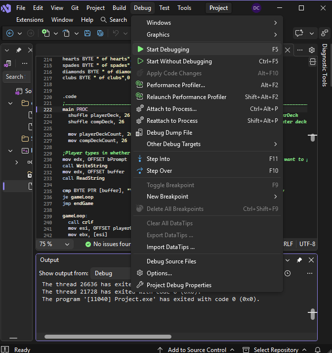
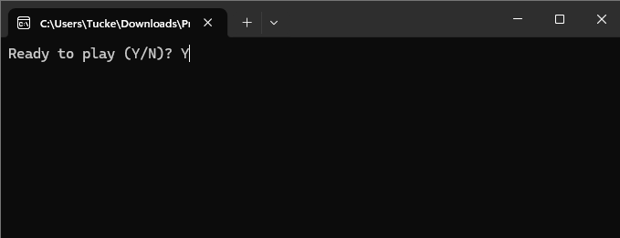
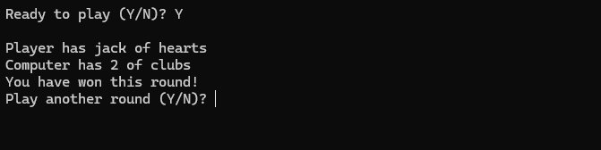
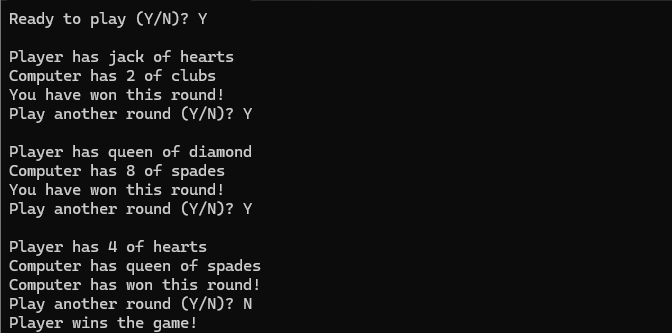

# Game-Contest-1

## How to use

1. Download repository
2. Run Project.sln in Visual Studio
3. Pull up cards.asm
4. Run debugger   
   
6. Type in Y to play   
   
   
7. Program shows player and computer cards. Type Y to continue to next round   
   
   
8. Repeat 6 & 7 until game is over or you want to quit. Type any character other than Y to quit
   
   

## Sources

https://broman.dev/download/Assembly%20Language%20for%20x86%20Processors%207th%20Edition.pdf

Google: Typed "how to use loops inside of a macro irvine"

